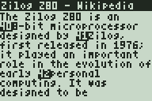
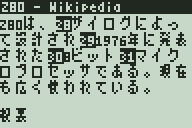

# lwIP-84+

A small operating system for the original monochrome **TI-84 Plus and
TI-84 Plus Silver Edition** (Z80 at 15 MHz, 128 KiB RAM) with the
[lwIP](https://savannah.nongnu.org/projects/lwip/) TCP/IP stack, a USB
network interface, a TLS 1.3 client, a text web browser and an SSH client.




- Only the early hardware revisions with **128 KiB of RAM** are supported,
  not the later ones with 48 KiB.
- It replaces TI-OS, which leaves too little memory for a network stack.
  TI-OS can be reinstalled from the boot code at any time.
- lwIP 2.2.1 is a git submodule (`lwip/`), used unchanged except for
  `patches/`. The port started as a branch of
  [lwIP-CE](https://github.com/cagscalclabs/lwip-ce), the lwIP library for
  the TI-84 Plus CE.

```
git clone --recursive https://github.com/MaxSignal/lwip84.git
```

## Connecting

The calculator is a **USB CDC-NCM device**: on a PC it appears as a USB
network adapter (Linux `cdc_ncm`, Windows 10+ `UsbNcm`, macOS), and the PC
shares its network with DHCP and NAT.

```
TI-84 Plus  --USB (CDC-NCM)-->  PC (DHCP + NAT)  -->  network
```

Linux with NetworkManager (the interface is named after the MAC address
`02:84:84:00:00:01`):

```
nmcli connection add type ethernet ifname enx028484000001 con-name ti84 ipv4.method shared
```

On Windows, enable Internet Connection Sharing for the new adapter.

## Status

| Part | Tested |
|------|--------|
| OS: boot, LCD console, keypad, timer, power off | hardware |
| USB peripheral driver (MUSBFDRC), CDC-NCM | hardware (Linux) |
| ARP, IPv4, ICMP, UDP, TCP, DHCP, DNS | hardware, emu84 |
| SNTP, TLS 1.3 client | emu84 |
| Web browser (HTTP, HTTPS, forms, search) | emu84 |
| External font (Japanese) | emu84 |
| SSH client (password login, shell) | emu84, against OpenSSH 9.6 |

Hardware: TI-84 Plus (revision 2, boot code 1.00) on Linux; the hardware
tests were made with lwIP-CE's copy of lwIP.

## Applications

The OS starts in the network console; **APPS** opens the menu (1 web
browser, 2 SSH client, 3 network console). **2nd+ON** turns the calculator
off, **ON** turns it on again.

### Typing

| Key | Effect |
|-----|--------|
| ALPHA | cycles the mode: `1` digits, `A` upper case, `a` lower case (shown in the status line) |
| letters | the green ALPHA labels (MATH = A ... 2 = Z); 0 is a space, `.` is `:`, `(-)` is `?`, `+` is `"`, 3 is `_` |
| digits mode | 0-9 `.` `,` `(` `)` `+` `-` `*` `/` `^`, STO is `=` |
| 2nd + key | one symbol: `,`→`;` `(`→`{` `)`→`}` `*`→`[` `-`→`]` `/`→`\|` `^`→`~` `+`→`'` `.`→`_` `0`→`` ` `` STO→`=` LOG→`<` LN→`>` x²→`\` x⁻¹→`$` MATH→`!` APPS→`@` PRGM→`#` SIN→`%` COS→`&` TAN→`*` `(-)`→`?` |
| DEL / CLEAR | delete a character / clear the line (CLEAR on an empty line cancels) |
| LEFT/RIGHT, UP/DOWN | move the cursor, start/end of the line |

### Web browser

HTTP/1.0 and HTTPS with its own HTML renderer (`os/html.c`; no CSS, no
JavaScript). The page is laid out as it arrives, 24 columns wide:

- headings, paragraphs, lists, tables (`header: value` for `th`/`td`
  pairs), `pre`; entities and UTF-8 are decoded: Latin letters lose their
  accents, Japanese and other characters of the [external font](#external-font)
  are shown with it, the rest become `?`;
- invisible content is skipped (`script`, `style`, `svg`, `hidden`,
  `display:none`, Wikipedia's menus and edit links, ...);
- links and form fields are numbered, the number drawn inverted;
- forms: text and password fields, text areas, check boxes, radio buttons,
  lists, submit buttons and hidden fields, sent with GET or POST.

Words typed into the URL line (anything with a space, or without a dot) are
searched with [DuckDuckGo Lite](https://lite.duckduckgo.com/lite/), which
works without JavaScript (Google's search does not). Too many searches from
one address can get a picture challenge from DuckDuckGo, which cannot be
solved here.

| Key | Action |
|-----|--------|
| Y= | URL or search words |
| 0-9, ENTER | use item `n`: follow a link, edit a field, toggle a check box, choose a radio button or a list entry, press a button |
| UP/DOWN, LEFT/RIGHT | scroll by a line, by a screen |
| GRAPH | top of the page / start of the main content |
| DEL | back |
| ENTER | reload |
| CLEAR | stop loading |
| MODE | back to the menu (the page is kept) |

ENTER in the only text field of a form (a search box) sends the form. A
page keeps up to 1600 lines.

### SSH client

Enter `host[:port]`, the user name and the password. `curve25519-sha256`,
`chacha20-poly1305@openssh.com`, password or keyboard-interactive login,
a 24x9 VT100 subset with scrollback. The host key is **not** checked.

| Key | Sends / does |
|-----|--------------|
| ENTER, DEL | CR, backspace (7Fh) |
| CLEAR, VARS, MODE | Ctrl-C, Tab, Esc |
| XT,θ,n then a key | Ctrl + that key |
| arrows | cursor keys |
| 2nd+UP / 2nd+DOWN | scroll back / forward |
| 2nd+MODE | disconnect |

### Network console

| Key | Action |
|-----|--------|
| Y= | status: USB, NTB counters, gateway, DNS, free heap |
| WINDOW / ZOOM | ping the gateway / DNS lookup of example.com |
| TRACE | HTTP GET http://example.com/ |
| 2nd, MATH | HTTPS GET https://example.com/ |
| MATH | HTTPS GET https://gateway:4433/ (for example `openssl s_server -www`) |
| GRAPH / VARS | TCP echo with gateway:8084 / download test from gateway:8085 |
| PRGM | crypto self test and timing |
| MODE / STAT | SNTP time sync / show the time |
| CLEAR, UP/DOWN | clear, scroll back |

## Security

This is an experiment tuned for speed; **the connections are not secure**:

- TLS: no certificate, CertificateVerify or Finished checks, received
  record tags are not checked, and the X25519 private key is 1
  (`KX_INSECURE_FAST`), so anybody who records the traffic can decrypt it.
- SSH: the host key and its signature are not checked, received MACs are
  not verified.
- Random numbers come from xorshift32 (`RNG_INSECURE_FAST`).
- Received IP/TCP/UDP checksums are not checked (USB has its own CRC).

## Speed

15 MHz, measured in emu84:

| | |
|---|---|
| HTML renderer | about 40 KB/s |
| page over HTTP (network stack + renderer) | about 9 KB/s (337 KB in 38 s) |
| page over HTTPS | about 4 KB/s (337 KB in 81 s); the first screen appears after a few seconds |
| AES-128 / ChaCha20 decryption (Z80 assembly) | 12.3 / 7.3 KB/s |
| SHA-256 (Z80 assembly) | 3.4 KB/s |
| TLS 1.3 full handshake | about 2 s of CPU time after the ServerHello (resumed: 1.3 s) |
| SSH: connect to shell | about 3 s |

## Building

Requirements: **SDCC 4.4.0** (4.5.0 miscompiles variable shifts), Python 3,
GCC (emulator, host tests), `patch`, and
[mktiupgrade](https://github.com/KnightOS/mktiupgrade).

```
make                      # build-84p/lwip84.8xu (OS upgrade) and lwip84.rom
make MODEL=84pse          # TI-84 Plus Silver Edition
make DEBUG=1              # debug build: log on the LCD (or in emu84)
make emu                  # the emulator, build-84p/emu84
make FONT=other.bdf       # another external font (FONT= for none)
```

The Makefile looks for SDCC in `../tools/sdcc-4.4.0/bin` and other tools in
`../tools/local/bin`; override with `SDCC_BIN=` and `TOOLS=`.
`tools/get-key.sh` downloads TI's public OS signing key `0A` into `keys/`.

Every push to `main` builds both models, runs the tests and publishes the
`.8xu` and `.rom` files as a GitHub release (`.github/workflows/build.yml`).

## Installing

Back up the calculator first: TI-OS and RAM are replaced. Then send the
`.8xu` as an OS upgrade from the boot code: remove a battery, hold DEL while
putting it back, plug in the USB cable when "Waiting..." appears, and send
the file within about 50 seconds (TiLP, TI Connect, or
`ti84link sendos FILE.8xu --force`, retried every few seconds because the
boot code answers slowly). Boot code 1.03 and newer need a workaround such
as UOSRECV, as for KnightOS.

On Linux, `tools/flash-calc.sh` does it all (backup with a ROM dump, send,
wait for the network); `sudo tools/host-setup.sh` once installs the udev
rules and the NetworkManager profile. `tools/build-ti84link.sh` builds
`ti84link` against a locally unpacked libticalcs.

To go back to TI-OS, send TI's OS upgrade the same way.

## How it works

### Memory and code banking

```
0000-3FFF  flash page 0: reset, interrupts, far-call thunks, constants, USB FIFO code
4000-7FFF  bank A: the flash page of the running code
8000-FFFF  RAM: static data (12 KiB, mostly lwIP pools), heap (17 KiB), stack (2 KiB)
```

`tools/banker.py` spreads the functions over flash pages and rewrites the
SDCC output: calls to another page and function pointers go through a
4-byte thunk in page 0 (`rst 10h`, page, address) that switches bank A and
keeps the return information on a far stack. Constants named `*_bk` (font,
tables) stay in flash next to the function that uses them. The boot code
does not run code on pages 08h-29h (08h-69h on the SE), so code is on pages
01-07 and 33-39 plus the crypto page 3B (73-79 and 7B on the SE). Page 3Ah
(7Ah) is left alone, the boot code keeps the OS header there. Pages 08h-29h
hold data: the external font from 08h on, the rest is free.

The six other RAM pages (96 KiB) are reached through `xram_read` /
`xram_write` and hold the web page (64 KiB), the SSH scrollback (24 KiB)
and the console history.

### External font

Characters that cannot be shown in ASCII are drawn with a bitmap font on the
flash data pages. The default is [k6x8](https://littlelimit.net/k6x8.htm)
(6x8 pixels, JIS levels 1 and 2 with kana, Greek and Cyrillic, 7096
characters), which makes Japanese pages readable.

- `tools/mkfont84.py` converts a BDF font (cells up to 8x8 pixels, code
  points up to U+FFFF) into a 64 KB blob: a table by the high byte of the
  code point, the sorted low bytes, a width bit and 8 bytes of pixels per
  glyph, and a checksum.
- `tools/mkrom.py` puts it on pages 08h-0Bh and adds them to the `.8xu`.
  mktiupgrade adds the first page of every 64 KB flash sector, and the boot
  code erases a sector when it receives that page, so the data pages are
  written cleanly.
- `os/font.c` checks the checksum at start-up (the network console's status
  shows `font ok`; without a valid font such characters stay `?`) and finds
  a glyph by binary search, with a cache of recent characters.
- In page text a glyph takes two cells: a lead byte 01h-1Fh and a trail byte
  01h-FFh, which together give the glyph number, so text stays a plain
  string and ASCII keeps its meaning. A row with glyphs is 8 pixels high
  (7 rows of text), other rows stay 6 pixels (9 rows). Lines may break
  between two glyphs, as Japanese has no spaces.

A Japanese Wikipedia article is laid out at about 5 KB/s (emu84; English
pages about 9 KB/s). `html_test -f build-84p/font.bin FILE.html` shows the
page with the font on the host.

### Network

| Path | Contents |
|------|----------|
| `os/usb.c`, `os/ncm.c` | USB peripheral driver, CDC-NCM function (NTB16) |
| `port/netif_ncm.c`, `port/net84.c` | lwIP interface, start-up, DHCP, main-loop service |
| `port/sock84.c` | sockets for the applications |
| `port/tls84.c` | TLS 1.3 client as an lwIP altcp layer |
| `include/lwipopts.h` | lwIP configuration |
| `patches/` | lwIP fix: stop the TCP persist timer when nothing is left to send |

`port/sock84.h` is what the applications use:

```
struct sock *s = sock_new(SOCK_TLS, 120000, event_cb);   /* or SOCK_TCP */
sock_connect(s, "example.com", 443);   /* waits for DHCP, resolves, connects */

void event_cb(struct sock *s, uint8_t ev, uint8_t a, int8_t err)
{
    if (ev == SOCK_EV_STATE && a == SOCK_CONNECTED)
        sock_write(s, request, len);
}

/* main loop */
while ((n = sock_available(s)) != 0)
    n = sock_read(s, buf, n > sizeof(buf) ? sizeof(buf) : n);
if (!sock_is_active(s))
    sock_free(s);
```

Received data stays in lwIP's pbufs until it is read, and the TCP window
opens as it is read. Events come from the main loop, never from inside
lwIP.

### TLS

TLS 1.3 with X25519 and `TLS_AES_128_GCM_SHA256`, which every TLS 1.3
server must support; a host that refuses it gets
`TLS_CHACHA20_POLY1305_SHA256` on the next attempt. Records are decrypted
in place as a stream, so 16 KiB records need no 16 KiB buffer. Session
tickets are kept for the last host and used for PSK resumption. No
HelloRetryRequest, early data or KeyUpdate.

AES, GHASH, ChaCha20, Poly1305, SHA-256 and the X25519 field arithmetic are
Z80 assembly produced by `tools/gen_*_z80.py` on one fixed flash page (3Bh,
7Bh on the SE); the rest is C (`crypto/`). AES suits an 8-bit CPU better than
ChaCha20 (bytes and a table instead of 32-bit additions and rotations).

## Testing

`emu84` runs the OS image headless, including the boot code's execution
protection, with a virtual USB host that speaks CDC-NCM and bridges the
frames to [passt](https://passt.top) for real network access without root:

```
tools/run-passt.sh /tmp/passt.sock &          # calculator 192.168.84.2, PC 192.168.84.1
build-84p/emu84 -d -u -n /tmp/passt.sock build-84p/lwip84.rom <<EOF
run 3000
key trace
run 6000
screen
EOF
```

Commands: `run MS`, `waitlog TEXT MS`, `key NAME`, `down`/`up NAME`, `on`,
`screen [FILE.pbm]`, `regs`, `dumpram FILE`, `profile on|FILE`, `quit`.
The PC's `127.0.0.1` is `192.168.84.1` for the calculator.
`tools/typekeys.py [--mode a] TEXT` turns text into `key` commands, `tools/pbm2png.py`
converts screens.

Host tests (also run by CI):

```
gcc -O2 -o ../tmp/z80run tests/z80run.c
python3 tests/asm_test.py aes 30           # also sha256, poly1305, ghash: Z80 code vs Python
gcc -O2 -I crypto -I tests -o ../tmp/aes_test tests/aes_test.c crypto/aes.c && ../tmp/aes_test
gcc -O2 -I crypto -o ../tmp/crypto_test tests/crypto_test.c crypto/sha256.c crypto/chacha.c crypto/x25519.c && ../tmp/crypto_test
gcc -O2 -DHTML_HOST -I os -o ../tmp/html_test tests/html_test.c os/html.c os/font.c && sh tests/html_check.sh ../tmp/html_test
```

`html_test -i FILE.html` shows how a saved page is rendered.

## License

BSD (see `COPYING`); lwIP is BSD, `emu/third_party/z80.h` is from
[floooh/chips](https://github.com/floooh/chips) (zlib), the k6x8 font in
`fonts/k6x8/` is by Num Kadoma and free to use, copy and modify
(`fonts/k6x8/k6x8.txt`).
