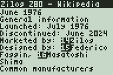
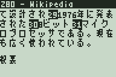
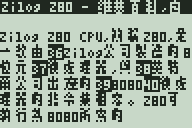
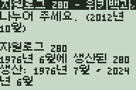
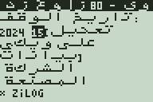
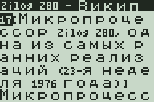
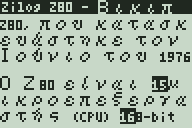
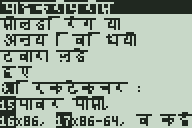

# Web browser

A text web browser for lwIP-84+: HTTP/1.0 and HTTPS with its own HTML
renderer (no CSS, no JavaScript), forms and search. **APPS, 1** opens it;
in TI-OS it is the app `lwIPweb` ([platform/](../../platform/README.md)),
which can also download TI-OS programs and appvars (`.8xp`, `.8xv`, `.8xg`,
also from a `.zip`) straight into TI-OS (`tidl.c`).

| English | 日本語 | 中文 | 한국어 |
|:-:|:-:|:-:|:-:|
|  |  |  |  |
| **العربية** | **Русский** | **Ελληνικά** | **हिन्दी** |
|  |  |  |  |

The Z80 articles of Wikipedia in each language (in Hindi, the article on
microprocessors), in emu84.

| File | Contents |
|------|----------|
| `browser.c` | user interface, HTTP, forms, history |
| `html.c`, `html.h` | streaming HTML renderer and form store |
| `tests/` | the renderer on the host (`html_test.c`) and its test pages |

## Using it

| Key | Action |
|-----|--------|
| Y= | URL or search words |
| 0-9, ENTER | use item `n`: follow a link, edit a field, toggle a check box, choose a radio button or a list entry, press a button |
| UP/DOWN, LEFT/RIGHT | scroll by a line, by a screen |
| GRAPH | top of the page / start of the main content |
| DEL | back |
| ENTER | reload |
| CLEAR | stop loading |
| MODE | back to the menu (the page is kept) |

Text is typed as described in the [main README](../../README.md#typing).
Links and form fields carry numbers, drawn inverted in front of them. ENTER
in the only text field of a form (a search box) sends the form; a list
opens a chooser (UP/DOWN, ENTER, CLEAR).

Words typed into the URL line (anything with a space, or without a dot) are
searched with [DuckDuckGo Lite](https://lite.duckduckgo.com/lite/), which
works without JavaScript (Google's search does not). Too many searches from
one address can get a picture challenge from DuckDuckGo, which cannot be
solved here. Result links are followed directly, not through DuckDuckGo.

## What it shows

The page is laid out as it arrives, 24 columns wide:

- headings (h1-h3 in capitals), paragraphs, lists with bullets or numbers
  and indentation, tables (`header: value` for `th`/`td` pairs), `pre`;
- invisible content is skipped: `script`, `style`, `svg`, `template`,
  elements with `hidden`, `aria-hidden="true"` or `display:none`, and a few
  classes (`noprint`, `navbox`, `mw-editsection`, `reference`, the menus of
  Wikipedia's Vector skin, ...);
- forms: text and password fields, text areas, check boxes, radio buttons,
  lists, submit buttons (`input` and `button`) and hidden fields, sent with
  GET or POST (`application/x-www-form-urlencoded`). Controls outside a form
  and buttons that are not submit buttons need JavaScript and are left out;
- frames: a page made of frames lists them as links;
- entities and UTF-8 are decoded, and Shift_JIS and EUC-JP (named in the
  HTTP header or a `<meta>` in the first KiB) with a table on flash pages
  2Ah-2Bh (`tools/mkjis84.py`, Windows' code page 932). Latin letters lose their accents;
  Japanese, Chinese, Hangul, Arabic, Devanagari, Greek and Cyrillic are drawn
  with the [external font](../../README.md#external-font), the rest is `?`.

Scripts that need more than one glyph per character:

- Arabic: the letters of a word are collected and each gets its isolated,
  initial, medial or final form from its neighbours (no lam-alef
  ligatures; harakat are not shown); runs of Arabic on a line are stored
  right to left.
- Devanagari: words break only at spaces; the vowel sign i is moved in
  front of its consonant cluster, the other vowel signs and marks are drawn
  over the glyph before them. No conjunct ligatures.
- CJK and Hangul: a line may break between any two characters.

A page keeps up to 1600 lines; a longer one is cut ("page truncated") and
the download stops.

## How it works

`html.c` is a byte-at-a-time state machine, so the page can be fed in pieces
of any size. Tag and attribute names are looked up by hash; only the
attributes that matter are kept. A stack of open elements closes elements
the way browsers do (`p`, `li`, `td`, `tr`, `option`, ...) and hides whole
subtrees. The hot path (plain words) runs at about 40 KB/s on the Z80.

The page lives in extended RAM (64 KiB): lines of 24 cells (37.5 KiB),
links and fields (9 KiB), their strings (14.75 KiB). The history keeps the
URL and, for pages that were sent with POST, the request body (7 entries),
so DEL returns to a search result.

HTTP/1.0 with `Accept-Encoding: identity`, redirects (5 at most), chunked
bodies; the `Referer` is sent with links and forms.

Speed in emu84 (15 MHz): a 337 KB Wikipedia article loads in 38 s over HTTP
and 81 s over HTTPS (AES-128-GCM), but its beginning is on the screen after
a few seconds; a DuckDuckGo search takes 10-25 s.

## Testing on the host

```
gcc -O2 -DHTML_HOST -I app/browser -I lib/font -o ../tmp/html_test \
    app/browser/tests/html_test.c app/browser/html.c lib/font/font.c
../tmp/html_test -i page.html                     # page, links and fields
../tmp/html_test -f build-84p/font.bin page.html  # with the external font
sh app/browser/tests/html_check.sh ../tmp/html_test build-84p/font.bin build-84p/jis.bin
```

`html_check.sh` renders `tests/pages/*.html` whole, byte by byte and in
random pieces and compares them with the `.txt` files (the `*.jis.html`
pages only with the font and the Shift_JIS table). `-j JIS.bin` gives
`html_test` the table.
