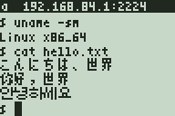

# SSH client

An SSH client for lwIP-84+ with a small VT100 terminal. **APPS, 2** opens
it.



| File | Contents |
|------|----------|
| `ssh.c` | SSH transport, key exchange, user authentication, one shell session |
| `term.c`, `term.h` | terminal emulator and scrollback |

## Using it

Enter `host[:port]`, the user name and the password (typed as described in
the [main README](../../README.md#typing)).

| Key | Sends / does |
|-----|--------------|
| ENTER, DEL | CR, backspace (7Fh) |
| CLEAR, VARS, MODE | Ctrl-C, Tab, Esc |
| XT,θ,n then a key | Ctrl + that key (for example XT,θ,n then D: Ctrl-D) |
| arrows | cursor keys |
| 2nd+UP / 2nd+DOWN | scroll back / forward |
| 2nd+MODE | disconnect and return to the menu |

## What it does

- `curve25519-sha256` key exchange, `chacha20-poly1305@openssh.com`,
  password or keyboard-interactive login, one shell on a pty;
- the host key and its signature are **not** checked and received MACs are
  not verified (see [Security](../../README.md#security));
- the terminal is a VT100/xterm subset: printable characters, CR, LF, BS,
  TAB, cursor movement, erase in line and display; colours and modes are
  swallowed. Lines scrolled off the top are kept in extended RAM (24 KiB,
  1024 lines);
- UTF-8: wide characters (CJK, kana, Hangul, full-width forms) are drawn
  with the [external font](../../README.md#external-font) in two columns,
  as the server's `wcwidth` counts them; Cyrillic and Greek in one column
  with the glyphs of the public domain misc-fixed 4x6 font
  (`tools/mknarrow84.py` writes `narrow.h`); accented Latin letters lose
  their accents; the rest (Arabic, Devanagari, ...) is `?` (two for
  characters outside the BMP). Writing
  over half of a wide character blanks the other half.
- other languages are typed with the input methods (2nd+ALPHA, see the
  [main README](../../README.md#other-languages)); what is being typed shows
  in the status line and is sent as UTF-8 when it is put in.

The terminal is 24x7 with the external font (8-pixel rows, so that the
glyphs fit) and 24x9 without it; the size is sent with the pty request.

The shell appears about 3 s after connecting (emu84, 15 MHz).

## Testing

`emu84` reaches services on the PC's `127.0.0.1` as `192.168.84.1`. A test
server with [asyncssh](https://asyncssh.readthedocs.io/) that accepts any
password:

```python
import asyncio, asyncssh

class Server(asyncssh.SSHServer):
    def begin_auth(self, username): return True
    def password_auth_supported(self): return True
    def validate_password(self, username, password): return True

async def shell(process):
    process.stdout.write('hello\r\n$ ')
    async for line in process.stdin:
        process.stdout.write('you typed: %s\r\n$ ' % line.strip())

async def main():
    await asyncssh.create_server(Server, '127.0.0.1', 2222, server_host_keys=['hostkey'],
                                 process_factory=shell)
    await asyncio.Future()

asyncio.run(main())
```
